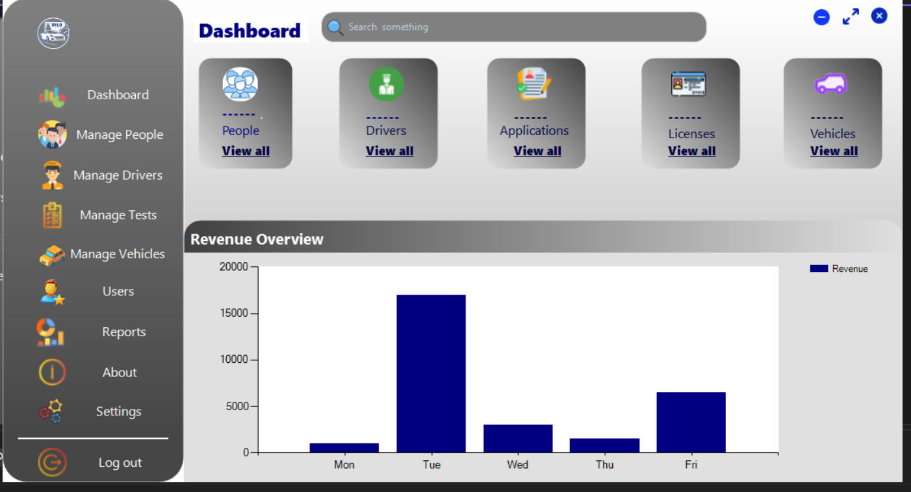

# 🚗 DVLD - Driving License Management System

A Windows Forms application built with C# and SQL Server to manage people, users, driving license applications, tests, and license-related operations.

## 📸 Screenshots



## 🏗️ Project Architecture

The project follows a layered architecture to separate responsibilities, improve maintainability, and make the system easier to extend.

### 1. Presentation Layer

The Presentation Layer contains the Windows Forms user interface and handles interaction with users.

**Main modules include:**

- `ApplicationsTypes/` — Manage application types.
- `Application Licenses/` — Manage license-related applications.
- `Internationl Driving License/` — International driving license functionality.
- `License Class Types/` — Manage license classes.
- `Manage Appointments/` — Manage test appointments.
- `ManageTestType/` — Manage test types.
- `Sechdule Tests/` — Schedule driving license tests.
- `People/` — Manage people and personal information.
- `Users/` — Manage system users.
- `Resources/` — Images and other visual resources.
- `Properties/` — Project properties and resources.
- `Settings/` — Application settings.
- `Program.cs` — Application entry point.

### 2. Business Layer

The Business Layer contains the application's business logic and rules.

Its responsibilities include:
- Processing application operations.
- Applying business rules and validation.
- Coordinating operations between the Presentation Layer and Data Access Layer.
- Managing business entities and application workflows.

### 3. Data Access Layer

The Data Access Layer handles communication with the database.

Its responsibilities include:
- Connecting to SQL Server.
- Retrieving records.
- Inserting new records.
- Updating existing records.
- Deleting records.
- Executing database queries and commands.

### 4. DTO Project

The Data Transfer Object (DTO) project contains objects used to transfer data between application layers, helping organize the data passed between components.

## 🔄 Architecture Flow

```text
Presentation Layer
        ↓
  Business Layer
        ↓
Data Access Layer
        ↓
     Database
```

The DTO project supports data transfer between the relevant layers.

## 🛠️ Technologies

- **Language:** C#
- **Framework:** .NET
- **User Interface:** Windows Forms
- **Database:** Microsoft SQL Server
- **Database Connectivity:** ADO.NET

## 🎯 Project Purpose

The goal of this project is to develop a structured Driving License Management System using a layered architecture.

By separating the user interface, business logic, data access, and data-transfer objects, the project aims to improve code organization, maintainability, and extensibility while supporting driving license management operations.

## 🚀 Key Features

- People management
- System user management
- Application type management
- Driving license application management
- License class management
- International driving license functionality
- Test type management
- Test appointment management
- Test scheduling functionality

*Note: Feature descriptions reflect the Presentation Layer modules currently included in the project. The availability of complete functionality depends on the implementation of each module.*

## 📌 Future Improvements

- Improve input validation and error handling.
- Expand testing and verification of business rules.
- Enhance the user interface and user experience.
- Continue improving database operations and project maintainability.
